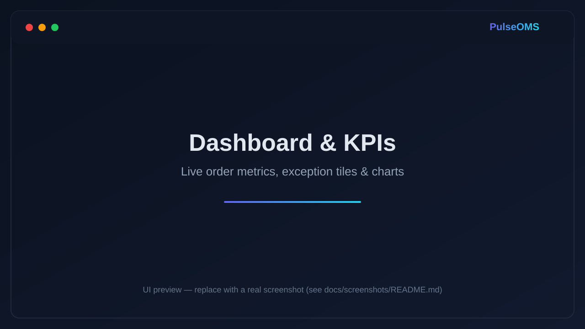
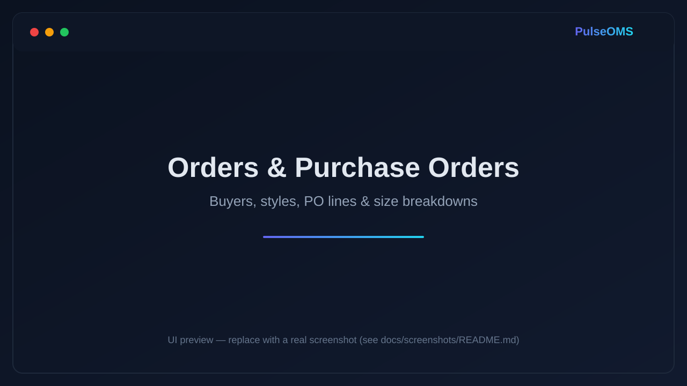
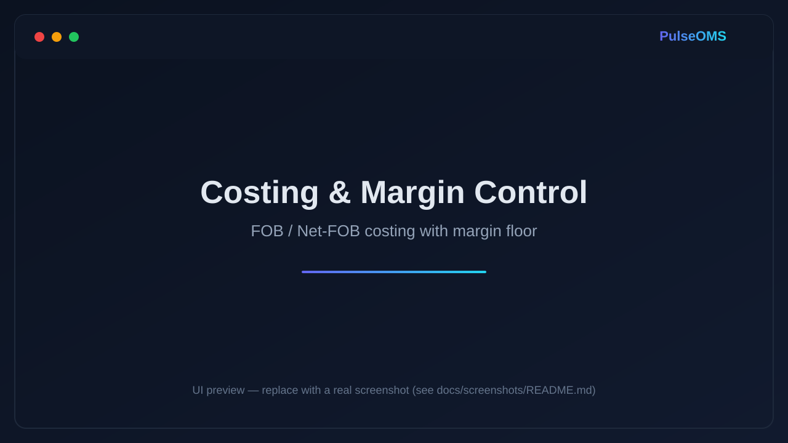
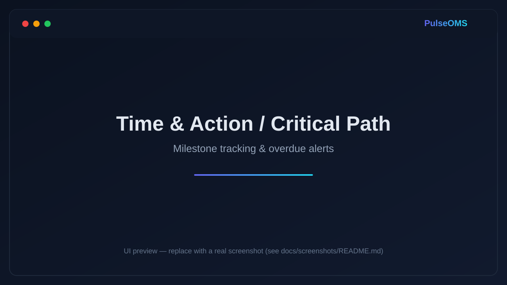
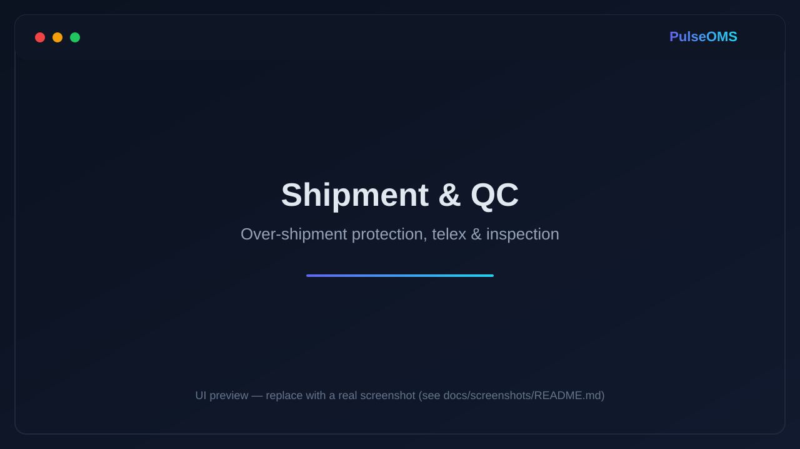
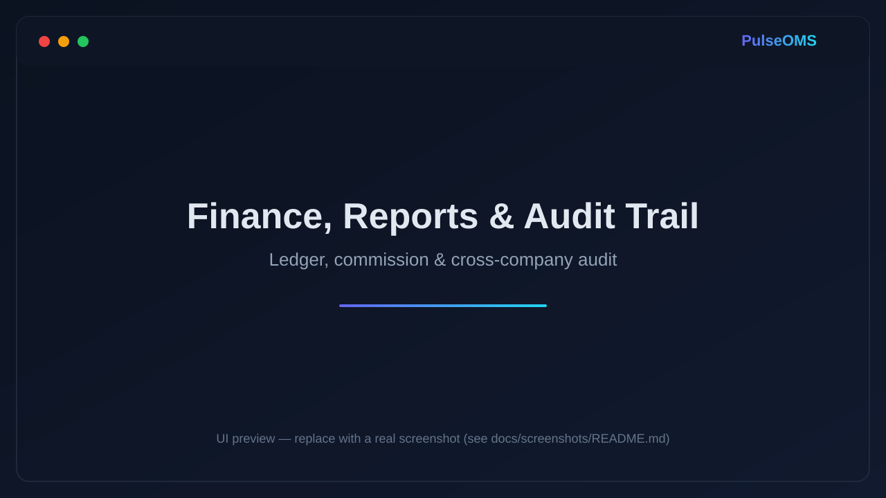

<div align="center">

# PulseOMS — RMG Order & Merchandising Management System

### A multi-tenant **Garment / Apparel ERP & Order Management System (OMS)** for buying houses, sourcing offices, and RMG factories.

Manage the full order lifecycle — **enquiry → costing → sampling → production → QC → shipment → finance** — in one fast, secure, cloud-based platform.

[](https://github.com/bemoshiur/RMG-Order-Merchandising-Management-System/actions/workflows/security.yml)


---

### 📱 Want a custom OMS / ERP built for your buying house or factory?

## **WhatsApp / Call: [+8801717714676](https://wa.me/8801717714676)**

_Custom software development · garment-industry systems · SaaS platforms_

</div>

---

## 📖 Table of Contents

- [What is PulseOMS?](#-what-is-pulseoms)
- [Screenshots](#-screenshots)
- [Key Features](#-key-features)
- [Security & Data Protection](#-security--data-protection)
- [Tech Stack](#-tech-stack)
- [Architecture](#-architecture)
- [Who It's For](#-who-its-for)
- [Why a Purpose-Built OMS Beats Spreadsheets](#-why-a-purpose-built-oms-beats-spreadsheets)
- [Getting Started](#-getting-started)
- [Testing](#-testing)
- [FAQ](#-faq)
- [Hire a Developer / Custom Builds](#-hire-a-developer--custom-builds)
- [Contact](#-contact)

---

## 🧭 What is PulseOMS?

**PulseOMS is a web-based Order Management System (OMS) and lightweight ERP built specifically for the ready-made garment (RMG) and apparel supply chain.** It replaces the scattered Excel sheets, WhatsApp threads, and email chains that most buying houses and factories rely on with a single source of truth for every buyer, style, purchase order, sample, shipment, and payment.

It is **multi-tenant SaaS** by design: one deployment can serve many companies, each with its own isolated data, users, roles, and subscription — with a platform super-admin console on top. The system is production-grade, fully typed, test-covered, and hardened with real-world security controls.

> In one sentence: **PulseOMS digitises garment merchandising and order-tracking end to end — costing, T&A / critical path, sampling, QC, shipment, and finance — with role-based access, a full audit trail, and enterprise-grade security.**

---

## 📸 Screenshots

> A picture is worth a thousand purchase orders. The gallery below showcases the interface. _(Screens use neutral demo branding — no live client data.)_

| Dashboard & KPIs | Orders & Purchase Orders |
| :---: | :---: |
|  |  |
| **Costing & Margin Control** | **Time & Action / Critical Path** |
|  |  |
| **Shipment & QC** | **Finance, Reports & Audit Trail** |
|  |  |

> 📷 **The gallery above uses labeled placeholders.** Replace them with real screenshots — drop your images into [`docs/screenshots/`](docs/screenshots/) using the same base file names. See [`docs/screenshots/README.md`](docs/screenshots/README.md) for the recommended shots and how to keep them client-neutral.

---

## ✨ Key Features

### 📋 Orders & Merchandising
- **Buyer, style & purchase-order management** with per-line quantities, size breakdowns, and colour/brand master data.
- **Enquiry-to-order pipeline** — capture enquiries and convert them into confirmed orders.
- **Order line editing with admin overrides** — post-confirmation and post-invoice changes are guarded and audited.

### 💰 Costing & Margin Control
- **FOB & Net-FOB costing** with fabric, trims, CM, and overhead cost items.
- **Live margin calculation** with a configurable **minimum-margin floor** that gates approvals so loss-making orders can't slip through.
- Price-wise reporting — one row per distinct FOB price per style.

### 🗓️ Time & Action (T&A) / Critical Path
- **Milestone templates** auto-applied to each order (fabric booking, PP sample, ex-factory, etc.).
- **Overdue alerts** and an at-a-glance critical-path view across all live orders.

### 🧵 Sampling & Development
- **Development items**, **buyer sample dispatch** tracking (courier, AWB, ETA), and a **sample movement ledger** (in/out).

### 🏭 Production, QC & Shipment
- **Production records** and **inspection / QC** logging.
- **Shipment management** with **over-shipment protection** enforced under serializable database transactions — you can never ship more than the order balance.
- **Telex release, commission status, and container/TC tracking** on shipped goods.

### 🧾 Finance
- **Invoices, payments, and a running ledger** with payment-status reconciliation.
- **Commission management** per buyer/factory with received/pending tracking.
- **BDT cash book** and CSV exports across every report (injection-safe).

### 🏢 Multi-Tenant SaaS & Administration
- **Company (tenant) isolation** — every query is scoped so no company can ever see another's data.
- **Role-based access control (RBAC)** with custom roles and a granular permission matrix.
- **Subscription & billing** with trial periods, plan management, and hosted-checkout payment integration.
- **Platform super-admin console** — manage all tenant companies, packages, and a **system-wide mega audit trail**.

### 📊 Dashboards & Reporting
- KPI dashboards, exception tiles (overdue milestones, missing docs, payment/telex reconciliation), and animated metrics.
- Filterable, exportable reports: Open Orders, Shipped Goods, Commission, Development, Sample Ledger, Factory-wise, and more.

### 📱 Progressive Web App (PWA)
- Installable on desktop and mobile, with a manifest, generated icons, and a responsive, mobile-first UI.

---

## 🔐 Security & Data Protection

Security is not an afterthought — PulseOMS ships with a defence-in-depth posture that most off-the-shelf garment tools simply don't have:

- ✅ **Full audit trail** — every create/edit/delete/approve and every auth event (login, logout, failed login, role change) is recorded with **user, IP address, and device/user-agent**.
- ✅ **Super-admin mega-audit** — a cross-company activity log with filters by company, action, entity type, date range, and free-text search.
- ✅ **Brute-force protection** — login rate-limiting enforced at the authentication choke point (bypass-proof, not just in the UI).
- ✅ **Session revocation** — disabling a user or changing their role takes effect immediately, not when their token expires.
- ✅ **Strict multi-tenant isolation** and **RBAC** on every server action.
- ✅ **HTTP security headers** — Content-Security-Policy, HSTS, `X-Frame-Options: DENY`, `X-Content-Type-Options`, Referrer-Policy, and a locked-down Permissions-Policy.
- ✅ **CSV formula-injection protection** on all exports (OWASP).
- ✅ **Automated security CI** — dependency vulnerability scanning (`npm audit`) and static security analysis (`eslint-plugin-security`) on every push.

> Need a security review or hardening of your existing system? **WhatsApp [+8801717714676](https://wa.me/8801717714676).**

---

## 🛠️ Tech Stack

| Layer | Technology |
| --- | --- |
| **Framework** | Next.js 16 (App Router), React 19 |
| **Language** | TypeScript (strict) |
| **Styling** | Tailwind CSS v4 |
| **Database** | PostgreSQL + Prisma 6 ORM |
| **Auth** | Auth.js (NextAuth v5) — JWT, credentials, RBAC |
| **Validation** | Zod |
| **Testing** | Vitest (unit + integration) · Playwright (E2E) |
| **CI / Security** | GitHub Actions · eslint-plugin-security · npm audit |
| **Hosting** | Vercel-ready · Neon / any Postgres |

---

## 🏗️ Architecture

- **App Router server components + server actions** — data mutations run server-side with permission + tenant guards; no ad-hoc API surface to secure.
- **Edge middleware (proxy)** for session-aware routing and public-route allow-listing.
- **Prisma schema** models the full domain: companies, users, roles, buyers, factories, styles, orders, lines, milestones, samples, shipments, invoices, payments, commissions, subscriptions, and audit logs.
- **Layered libs** (`src/lib/*`) keep business logic pure and testable, separate from UI.
- **Test-driven** — 250+ automated tests covering costing, permissions, tenant isolation, over-shipment concurrency, finance, and the audit trail.

---

## 🎯 Who It's For

- **Buying houses & sourcing offices** coordinating multiple buyers and factories.
- **Garment / apparel manufacturers** who need order, sample, and shipment visibility.
- **Merchandisers & merchandising managers** drowning in Excel and email.
- **Textile & RMG exporters** in Bangladesh and beyond who want a single, auditable system of record.

_Keywords: garment ERP, RMG order management, apparel merchandising software, buying house software, textile order tracking, garment production management, T&A calendar, tech pack, costing sheet, shipment tracking, Bangladesh garment software._

---

## 📈 Why a Purpose-Built OMS Beats Spreadsheets

| Spreadsheets & WhatsApp | PulseOMS |
| --- | --- |
| Data scattered across files & chats | One source of truth |
| No access control — everyone sees everything | Role-based permissions per user |
| No history of who changed what | Full audit trail with IP & device |
| Manual margin math, error-prone | Automatic costing + margin floor |
| Missed ex-factory dates | Automated T&A alerts |
| Over-shipping & reconciliation headaches | Enforced shipment balance & finance ledger |
| Hard to scale to more buyers/factories | Multi-tenant, cloud-native |

> A custom OMS pays for itself the first time it stops a loss-making order or a missed shipment. **Let's talk: WhatsApp [+8801717714676](https://wa.me/8801717714676).**

---

## 🚀 Getting Started

### Prerequisites
- **Node 20+**, and either a **Neon Postgres** URL or **Docker** (for local Postgres).

### Setup
```bash
cp .env.example .env          # set DATABASE_URL + AUTH_SECRET (openssl rand -base64 32)

# Option A — Neon (managed): put your Neon URL in .env as DATABASE_URL
# Option B — Docker (local):
docker compose up -d          # Postgres dev:5432, test:5433

npm install
npx prisma migrate dev        # apply migrations to the dev DB
npx dotenv -e .env.test -- prisma migrate deploy   # apply to the test DB (Docker option)
npm run db:seed               # seeds a demo company + admin (change the password immediately)
npm run dev
```

Open [http://localhost:3000](http://localhost:3000). **Change the seeded default password immediately after first login.**

---

## 🧪 Testing

```bash
npm test         # unit + integration (Vitest); needs a reachable test DB
npm run e2e      # Playwright E2E; needs dev server + seeded dev DB
npm run lint     # ESLint + security static analysis
npm audit        # dependency vulnerability scan
```

Unit-only tests (no DB required): password hashing, permission matrix, permission guard, CSV escaping, login rate-limiter.

---

## ❓ FAQ

**What is an OMS in the garment / RMG industry?**
An Order Management System (OMS) tracks apparel orders from buyer enquiry through costing, sampling, production, QC, and shipment, plus the finance around them. PulseOMS does all of this in one web app.

**Is PulseOMS multi-tenant?**
Yes. A single deployment serves many companies with fully isolated data, users, roles, and subscriptions, plus a platform super-admin console.

**Can it handle multiple buyers and factories?**
Yes — buyers, factories, brands, styles, colours, and size scales are all first-class master data, scoped per company.

**Is my data secure?**
Yes. PulseOMS enforces RBAC, strict tenant isolation, brute-force protection, HTTP security headers, and a complete audit trail with IP and device capture. See [Security & Data Protection](#-security--data-protection).

**Can it be customised for my company's workflow?**
Absolutely — that's the point. The system is modular and purpose-built. **WhatsApp [+8801717714676](https://wa.me/8801717714676)** to discuss your requirements.

**How much does a custom OMS / ERP cost?**
It depends on scope, integrations, and user count. Message **[+8801717714676](https://wa.me/8801717714676)** on WhatsApp for a free consultation and quote.

**Do you build other business software?**
Yes — SaaS platforms, ERPs, dashboards, and internal tools with the same engineering and security standards. Let's talk.

---

## 👨‍💻 Hire a Developer / Custom Builds

This project is built and maintained by a full-stack engineer specialising in **garment-industry software, multi-tenant SaaS, and secure business systems** — from design to production, with test-driven rigour and a security-first approach.

**Services:**
- Custom OMS / ERP for buying houses, sourcing offices, and factories
- Multi-tenant SaaS platforms & subscription billing
- Dashboards, reporting, and data pipelines
- Security reviews & hardening of existing apps
- Next.js / React / TypeScript / PostgreSQL development

### 📱 Ready to build? **WhatsApp / Call [+8801717714676](https://wa.me/8801717714676)** — available for further development.

---

## 📬 Contact

<div align="center">

### 📱 WhatsApp / Call: **[+8801717714676](https://wa.me/8801717714676)**

_For custom development, demos, and consultations._

**+8801717714676** · [Chat on WhatsApp →](https://wa.me/8801717714676)

</div>

---

## 📄 License

Proprietary — all rights reserved. This repository is shared as a portfolio / capability showcase. For licensing, deployment, or a custom build, contact **[+8801717714676](https://wa.me/8801717714676)**.

---

<div align="center">

**Built with Next.js, TypeScript & PostgreSQL — engineered for the RMG industry.**

⭐ If this project is useful or interesting, please star the repo.

📱 **WhatsApp for custom development: [+8801717714676](https://wa.me/8801717714676)**

</div>
